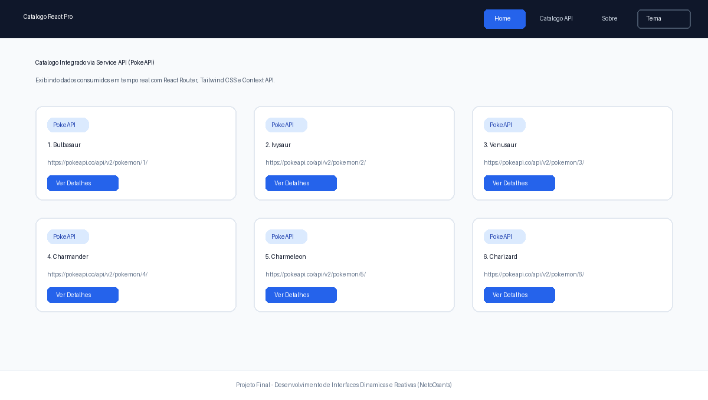
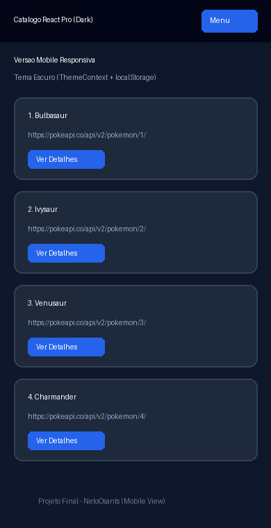

# Catálogo React Pro – Projeto Final (Semana 15/16)

Aplicação Single Page Application (SPA) completa desenvolvida em **React + Vite**, estilizada com **Tailwind CSS**, roteamento com **React Router**, alternância de tema Claro/Escuro via **Context API (`localStorage`)** e consumo de dados em tempo real da **PokeAPI**.

## Links de Acesso
- **Repositório no GitHub:** `https://github.com/NetoOsants/entregavel-8-semana-15-16`
- **Link do Deploy (Produção - Vercel):** `https://entregavel-8-semana-15-16.vercel.app`

## Prints de Tela (Desktop e Mobile)

### Versão Desktop (Tema Claro)


### Versão Mobile Responsiva (Tema Escuro)


## Tecnologias Utilizadas
- **React 18** (Hooks: `useState`, `useEffect`, `useContext`)
- **Vite** (Bundler e geração de build otimizado de produção)
- **Tailwind CSS** (Estilização responsiva Mobile-First e Dark Mode)
- **React Router DOM v6** (Rotas aninhadas com `Layout`, `NavLink` e `Outlet` + SPA Fallback configurado em `public/_redirects` e `vercel.json`)
- **PokeAPI** (Consumo assíncrono isolado na camada `services/api.js`)

## Instruções para Rodar Localmente
```bash
# 1. Clonar o repositório
git clone https://github.com/NetoOsants/entregavel-8-semana-15-16.git

# 2. Acessar a pasta do projeto
cd entregavel-8-semana-15-16

# 3. Instalar as dependências
npm install

# 4. Iniciar o servidor de desenvolvimento
npm run dev

# 5. Testar o build de produção localmente
npm run build
```

## Parte 4 – Reflexão (Para Pensar)

**Qual o impacto de ter um projeto documentado e publicado no seu portfólio como desenvolvedor? Por que o README é a primeira coisa que um recrutador lê?**

- **Impacto do projeto publicado e documentado:** Um projeto com link de deploy ativo permite que recrutadores, clientes e líderes técnicos testem a aplicação imediatamente no navegador (tanto no computador quanto no celular), comprovando na prática que você domina o ciclo completo de engenharia de software — do código ao ambiente de produção.
- **Por que o README é a primeira coisa que um recrutador lê:** O `README.md` é o cartão de visitas do repositório. Antes de abrir qualquer arquivo de código, o recrutador lê o README para entender **qual problema o projeto resolve, quais tecnologias e decisões arquiteturais foram utilizadas, visualizar os prints da interface (Desktop/Mobile), saber como rodar o projeto localmente e acessar o link do deploy**. Um README bem estruturado demonstra organização, clareza de comunicação e maturidade profissional.
